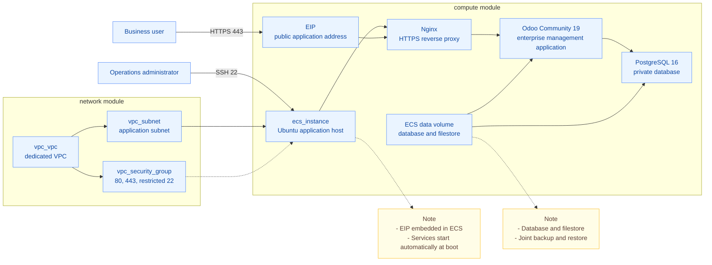

# Quick Deployment of the Odoo Community Enterprise Management Suite

Odoo Community is an open-source, modular enterprise management suite that helps organizations manage customers and opportunities, sales orders, procurement, inventory, manufacturing, and projects. Its modules share business data and can be enabled as needed to connect workflows from customer engagement through order delivery, reducing duplicate data entry and cross-department coordination costs. This solution uses Terraform to automatically create Volcengine networking, compute, and storage resources, while a bootstrap script installs and configures Odoo and its dependencies. The deployment is reviewable and reusable, and resource changes can be previewed before execution. This reduces manual work and environment drift, making it easier to quickly build demonstration, validation, and small non-critical business environments.

## 1. Business Background

Manual Odoo deployment commonly presents the following challenges:

- **Inconsistent environments**: Differences in operating systems, application builds, and dependency installation steps make identical environments difficult to reproduce.
- **Unclear access boundaries**: Public entry points, application ports, and database connections lack explicit access controls.
- **Incomplete backups**: Database records and attachments are stored separately, so backing up only one cannot restore the complete business state.
- **Fragmented initialization steps**: After the cloud server is created, software installation, database creation, and service configuration still need to be performed separately.

This solution defines networking, compute, and storage as a reviewable Terraform project and uses a first-boot script to install and configure Odoo, PostgreSQL, and Nginx. It uses a single ECS instance and is intended for demonstrations, functional validation, and small non-critical workloads. It does not provide production high availability.

## 2. Solution Overview

- **Deployment architecture**: Creates an Ubuntu Elastic Compute Service (ECS) instance in a Virtual Private Cloud (VPC). Odoo Community 19, PostgreSQL, and Nginx run on the same instance, which is exposed through an Elastic IP (EIP).
- **Access method**: Business users access Odoo through the Nginx HTTPS endpoint. Application and database ports are not exposed publicly, and SSH access is restricted by `admin_cidr`.
- **Data storage**: The database, attachments, and custom modules are stored on a dedicated data volume. The backup tool saves the database and files in one backup set, which must be used together during restoration. Backups must also be copied off the instance.
- **Automatic initialization**: On first boot, the specified Odoo build is downloaded and its package checksum is verified before installation. The script then configures the database, reverse proxy, and initial administrator credentials. The initial HTTPS certificate is self-signed and must be replaced with a trusted certificate before production access.



A self-signed HTTPS certificate is generated during the first boot. Replace it with a trusted certificate for the business domain before allowing production users to connect. The bootstrap script initializes only the Odoo base modules; users enable Community modules such as CRM and Sales as needed.

## 3. IaC Design

This project uses Infrastructure as Code (IaC). Terraform defines the cloud resources, and the VolcengineCC provider invokes the Volcengine resource orchestration APIs.

### 3.1 Resource Inventory

This solution creates four Volcengine resource objects and one Terraform helper used for a wait during destruction.

| Terraform Resource | Count | Purpose |
| --- | --- | --- |
| `volcenginecc_vpc_vpc` | 1 | Dedicated network boundary for Odoo |
| `volcenginecc_vpc_subnet` | 1 | Application subnet in the selected availability zone |
| `volcenginecc_vpc_security_group` | 1 | Inbound control for public ports 80/443 and SSH from the management CIDR |
| `volcenginecc_ecs_instance` | 1 | Ubuntu host with embedded networking, storage, and bootstrap configuration |
| `time_sleep` | 1 | A 60-second wait after ECS deletion and before network deletion; it does not create a cloud asset |

The EIP, system volume, data volume, and primary network interface are created with ECS and managed as ECS resource attributes. They do not have independent Terraform resource addresses. The application and database are installed inside ECS; no separate managed database, load balancer, or object storage service is created.

By default, deleting or replacing ECS also deletes the data volume. Setting `data_volume_delete_with_instance` to `false` retains the data volume, but after the original ECS is deleted, the retained volume is no longer managed through that Terraform resource address. It must be separately inventoried and reattached or deleted. Copy business backups off the instance before deleting or replacing it. See Sections 4.2.4 and 4.2.5 for the procedures.

### 3.2 Project Structure

```text
terraform-volcenginecc-enterprise-management-suite/
├── modules/
│   ├── network/
│   │   ├── main.tf
│   │   ├── variables.tf
│   │   ├── outputs.tf
│   │   └── versions.tf
│   └── compute/
│       ├── main.tf
│       ├── variables.tf
│       ├── outputs.tf
│       ├── versions.tf
│       └── templates/
│           └── odoo-bootstrap-native.sh.tftpl
├── main.tf
├── variables.tf
├── outputs.tf
├── providers.tf
├── versions.tf
├── locals.tf
├── terraform.tfvars
├── README.md
└── README.zh-CN.md
```

The project is divided into network and compute modules:

- **Root module**: Configures the provider, consolidates deployment parameters, orchestrates child-module dependencies, and sets the destruction wait.
- **`network` module**: Creates the VPC, subnet, and security group, then passes their resource IDs to the compute module.
- **`compute` module**: Creates ECS and its EIP, volumes, and primary network interface, and delivers the application bootstrap script through `user_data`.

Child modules declare only provider version constraints and use the provider configuration from the root module.

### 3.3 Key Code Examples

**Resource dependencies and destruction order**: The root module creates the network before ECS. Destruction follows `ECS -> wait 60 seconds -> security group -> subnet -> VPC`. The wait applies only during destruction and gives network-interface and security-group associations time to be released. It does not automatically remove dependencies from other resources. The following excerpt omits other compute-module inputs:

```hcl
resource "time_sleep" "before_security_group_destroy" {
  destroy_duration = "60s"
  depends_on       = [module.network]
}

module "compute" {
  source = "./modules/compute"
  # ...
  depends_on = [time_sleep.before_security_group_destroy]
}
```

**Application initialization**: The `compute` module inserts the Odoo version, package URL, SHA256 digest, and timezone into the script template. It then compresses the script with Gzip, encodes it with Base64, and passes it to ECS through `user_data`. cloud-init runs the script during the first boot to install and configure the application. The following excerpt omits other instance arguments:

```hcl
locals {
  bootstrap_script = templatefile("${path.module}/templates/odoo-bootstrap-native.sh.tftpl", {
    odoo_version        = var.odoo_version
    odoo_package_url    = var.odoo_package_url
    odoo_package_sha256 = var.odoo_package_sha256
    timezone            = var.timezone
  })
}

resource "volcenginecc_ecs_instance" "odoo" {
  # Other ECS arguments omitted.
  user_data = base64gzip(replace(local.bootstrap_script, "\r\n", "\n"))
}
```

### 3.4 Software Versions and Persistence

| Component | Installation Source |
| --- | --- |
| Odoo Community | aria2 downloads a pinned DEB from the official Odoo CDN |
| PostgreSQL | Ubuntu 24.04 repositories (major version 16) |
| Host OS | Ubuntu 24.04 public image specified by `image_id` |
| Reverse proxy | Ubuntu 24.04 Nginx package |

`odoo_package_url` and `odoo_package_sha256` pin the exact Odoo build. The default package is `odoo_19.0.20261018_all.deb`, with SHA256 `2966e651382c7c7796b7080f35f5907eea2ee50767cbaae9c1ba0909981fdda1`.

You can upgrade it as needed. Update the package URL, SHA256 digest, and `odoo_version` together, then complete regression testing in a new environment. Do not update a live business host directly.

The bootstrap script mounts the data volume at `/srv/odoo`:

| Path | Data |
| --- | --- |
| `/srv/odoo/postgresql` | PostgreSQL data files |
| `/srv/odoo/filestore` | Odoo attachments and filestore |
| `/srv/odoo/addons` | Custom add-ons directory; no modules are bundled by default |
| `/srv/odoo/secrets` | Runtime credentials with mode `0600` |
| `/srv/odoo/backups` | Local joint backup sets |

The filestore is the directory where Odoo stores attachments on the file system, while add-ons are extension modules. The database and filestore together constitute the business data and must be handled as a pair during backup and restoration.

The template does not include third-party add-ons. Before enabling any, review their source and license, pin their versions, and place the code in `/srv/odoo/addons`.

The script pre-creates the `odoo` database, and the application configuration always uses this database. The database user of the same name does not have superuser or role-creation privileges, but it retains the `CREATEDB` privilege. For a fixed single-database deployment that follows least privilege, evaluate whether this privilege is needed. After restricting it, revalidate initialization, module use, and restoration.

The Odoo database-management master password and initial web login password are generated randomly inside the instance. The credentials file normally has mode `0600`. The master password is also stored in plaintext in `/etc/odoo/odoo.conf`; this file is owned by root, belongs to the odoo group, and has mode `0640`, so root and members of the odoo group can read it.

These permissions restrict who can read the credentials but do not encrypt their contents. If your policy prohibits plaintext storage, you must implement a different storage design.

### 3.5 Input Variables

The table lists every root-module input. Variables marked as required have no default and must be supplied through `terraform.tfvars`, InfraManager parameters, or the command line.

| Variable | Default | Description |
| --- | --- | --- |
| `region` | `cn-beijing` | Deployment region |
| `zone_id` | Required | Availability zone for the subnet and ECS |
| `project_name` | `odoo` | Project identifier used in resource names and tags |
| `environment` | `demo` | Environment identifier |
| `owner` | Required | Resource Owner tag |
| `cost_center` | `shared` | Cost-center tag |
| `cloud_project_name` | `default` | Volcengine project name |
| `vpc_cidr` | `10.30.0.0/16` | VPC IPv4 CIDR |
| `subnet_cidr` | `10.30.1.0/24` | Application subnet IPv4 CIDR |
| `admin_cidr` | Required | Management CIDR allowed to use SSH |
| `image_id` | Required | Ubuntu 24.04 image ID available in the target region |
| `ecs_instance_type` | `ecs.g4i.xlarge` | ECS instance type |
| `ecs_login_mode` | `key_pair` | `key_pair` or `password` |
| `key_pair_name` | `null` | Existing key-pair name used in key-pair mode |
| `ecs_password` | Demonstration value, sensitive | Initial ECS password used in password mode |
| `ecs_system_volume_type` | `ESSD_FlexPL` | System-volume type |
| `ecs_system_volume_size_gb` | `40` | System-volume size in GiB |
| `ecs_data_volume_type` | `ESSD_FlexPL` | Odoo data-volume type |
| `ecs_data_volume_size_gb` | `100` | Odoo data-volume size in GiB |
| `data_volume_delete_with_instance` | `true` | Whether to delete the data volume with ECS |
| `eip_bandwidth_mbps` | `10` | ECS public-IP bandwidth in Mbps |
| `odoo_version` | `19.0` | Odoo Community major version |
| `odoo_package_url` | Pinned Odoo 19 DEB URL | Odoo package download URL |
| `odoo_package_sha256` | Pinned SHA256 | Odoo package checksum |
| `timezone` | `Asia/Shanghai` | ECS timezone |
| `additional_tags` | `{}` | Additional tags merged with the standard tags |

Before deployment, note the difference between variable defaults and example values:

- `ecs_login_mode` defaults to `key_pair`, while the example `terraform.tfvars` uses `password`.
- `zone_id`, `owner`, `admin_cidr`, and `image_id` have no defaults. The example supplies a Beijing-region configuration; when changing regions, recheck the image, availability zone, and instance type.
- The example `admin_cidr = "0.0.0.0/0"` exposes SSH to the entire Internet and must be replaced with the actual management CIDR.
- In password mode, the ECS login password is written to the Terraform state file. `sensitive` only hides the value from ordinary output; it does not encrypt state.

### 3.6 Outputs

| Output | Description |
| --- | --- |
| `vpc_id` | Odoo VPC ID |
| `subnet_id` | Application subnet ID |
| `security_group_id` | ECS security-group ID |
| `odoo_url` | Public Odoo HTTPS URL |
| `health_check_url` | Public Nginx health-check URL |
| `ecs_instance_id` | Odoo ECS instance ID |
| `ecs_private_ip` | ECS private address |
| `ecs_public_ip` | ECS public address |
| `data_volume_id` | PostgreSQL and filestore data-volume ID |
| `initialization_status_command` | Command for checking initialization and application status inside ECS |
| `initial_admin_credentials_command` | Command for viewing the initial Odoo administrator credentials inside ECS |

Terraform outputs do not contain the actual Odoo password. `initial_admin_credentials_command` returns only the command used to view credentials and must be run inside ECS; its result contains sensitive information.

## 4. Usage

You can deploy through InfraManager in the cloud or download the project and run Terraform locally. Cloud deployment does not require a local Terraform environment. For both methods, check the application initialization status inside ECS after the resources are created.

### 4.1 Cloud Deployment

InfraManager is Volcengine's managed Terraform workspace. For more information, see the [InfraManager product introduction](https://docs.volcengine.com/docs/infrastructure-management/product-introduction?lang=zh).

#### 4.1.1 Prepare Permissions

Grant the IAM identity or role that executes the stack the following permissions:

- CloudControl resource orchestration permissions.
- Create, read, update, delete, association, and tag-management permissions for VPCs, subnets, security groups, and security-group rules.
- Create, read, update, delete, association, and tag-management permissions for ECS, primary network interfaces, system volumes, data volumes, and public EIPs.
- Permissions required to read public images, availability zones, instance types, and quotas in the target region.

Use an IAM identity or stack execution role with these permissions. Do not use the primary account directly, and do not place Access Keys (AK/SK) in template parameters. Confirm in the consoles that ECS, VPC, EIP, and cloud disk services are available, the account balance is sufficient, the target region has enough EIP quota, and the selected availability zone has sufficient instance and cloud disk quota.

Key-pair login requires an existing key pair in the target region and secure custody of its private key. Password login requires a password that satisfies the `ecs_password` validation rules.

#### 4.1.2 Select the Template

Open the [InfraManager console](https://console.volcengine.com/iac), go to **Template Management > Public Templates**, and search for **Quick Deployment of the Odoo Community Enterprise Management Suite**.

#### 4.1.3 Create a Stack

Select the template and click **Create Stack**. Enter the stack information and template parameters for your requirements. Create and review the execution plan, then click **Deploy** after confirming that the changes are as expected.

Pay particular attention to the region, availability zone, image, instance type, management CIDR, login mode, data-volume deletion policy, and public bandwidth described in Section 3.5. Select exactly one login mode: key pair or password.

Choose EIP bandwidth before the first deployment. Changing bandwidth settings on an existing instance may cause instance replacement, so review the execution plan first. See Section 3.5 for the differences between variable defaults and example values.

#### 4.1.4 Verify the Deployment

A **Successful** stack status means that the cloud resources were created, but the application may still be initializing. Review the outputs in Section 3.6: use `ecs_instance_id` and `data_volume_id` to locate resources, `ecs_public_ip` to connect to the host, and `odoo_url` to access the application.

In the consoles, verify the VPC, subnet, security group, ECS instance, and the EIP, primary network interface, and two volumes associated with ECS. `time_sleep` is a Terraform wait object and does not correspond to a cloud asset.

From a management terminal whose source IP is within `admin_cidr`, use the SSH command that matches the selected login mode, or connect to the instance from the ECS console. Replace the placeholder with the public IP from the stack output. Key-pair mode requires the corresponding private key:

```bash
# Password mode:
ssh root@"<ecs_public_ip>"

# Key-pair mode:
ssh -i /path/to/private-key root@"<ecs_public_ip>"
```

Run the following commands inside ECS:

```bash
sudo cloud-init status --wait
sudo /usr/local/sbin/odoo-status
sudo pg_lsclusters
sudo findmnt /srv/odoo
sudo -u odoo psql -d odoo -c 'select current_database(), version();'
sudo /usr/local/sbin/odoo-credentials
```

Expect cloud-init initialization to finish, the status check to succeed, the actual PostgreSQL cluster to be `online`, `/srv/odoo` to be mounted on the data volume, and the database name to be `odoo`.

Open `odoo_url` in a browser, sign in with the initial `odoo-admin` credentials displayed by the last command, and change the password immediately. The initial certificate is self-signed and should be used only for deployment verification after confirming the target. Configure a trusted certificate before production access. `health_check_url` should return HTTP 200, and ordinary HTTP page requests should redirect to HTTPS.

Then complete items 2 through 6 in Section 4.2.4 to verify networking, business workflows, restarts, backup and restoration, and changes. For cloud deployment, set `ECS_IP`, `ODOO_URL`, and `HEALTH_URL` to the corresponding stack outputs; local state is not required. If initialization is abnormal, use that section to check networking, mounts, logs, and the database cluster.

### 4.2 Local Deployment

Run all Terraform commands below from the project root. First prepare permissions and services as described in Section 4.1.1, and keep the subnet created by this template dedicated to this deployment.

#### 4.2.1 Prepare the Environment

**Base environment**:

- Terraform `>= 1.5.7`, with access to Terraform Registry and Volcengine APIs.
- Provider version constraints are `volcengine/volcenginecc ~> 0.0.72` and `hashicorp/time ~> 0.9`. The project does not commit a dependency lock file (`.terraform.lock.hcl`). Review the versions resolved during initialization and keep them consistent across deployment environments.
- The management terminal needs SSH, curl, and `nc` for public-port checks. The target image must be Ubuntu 24.04 with cloud-init support. ECS must be able to reach the Ubuntu repositories and `nightly.odoocdn.com`.

**Services and quotas**:

Use the consoles to confirm the permissions, services, balance, image, instance type, and quotas described in Section 4.1.1. `image_id` has no default. The example image applies only to its corresponding region and must be selected again when changing regions. The default public bandwidth is 10 Mbps and affects download time; select an appropriate value during the first deployment.

**API access credentials**: Supply AK/SK through environment variables. Do not store them in code or `terraform.tfvars`:

```bash
export VOLCENGINE_ACCESS_KEY="your_access_key"
export VOLCENGINE_SECRET_KEY="your_secret_key"
export VOLCENGINE_REGION="cn-beijing"
```

The provider configures the region from the `region` variable, so `VOLCENGINE_REGION` does not override the `region` value in `terraform.tfvars`. Ensure that the region parameter, availability zone, and image match, and use credentials for the corresponding environment.

**ECS login password**: `ecs_password` provides ECS administrator login in password mode. Although it is marked sensitive, it is still stored in Terraform state. Inject it through an environment variable instead of writing the real password to `terraform.tfvars`.

The source and example contain a demonstration password that must be replaced before use. First remove or comment out `ecs_password` in the example file, then set the following environment variable. Otherwise, the value in `terraform.tfvars` overrides the environment variable:

```bash
export TF_VAR_ecs_password="<your-strong-password>"
```

The password must satisfy the variable validation rules: 8 to 30 characters, at least three of uppercase letters, lowercase letters, numbers, and special characters, only characters supported by ECS, and no leading `/` or `$6$`. Password mode also requires `key_pair_name = null`; see the next section for key-pair mode.

**Key parameters**:

See Section 3.5 for the complete parameter table. Pay particular attention to `zone_id`, `image_id`, `owner`, `admin_cidr`, and `ecs_login_mode`, and replace the example management CIDR `0.0.0.0/0` with an approved management CIDR.

See Section 3.4 for data storage and permission details. The Odoo master password and initial web login password are generated inside the instance and are unrelated to `TF_VAR_ecs_password`. Before deployment, confirm that storing the plaintext master password in a permission-restricted runtime configuration complies with your policy.

#### 4.2.2 Scenario-based Deployment Examples

Initialize and validate:

```bash
terraform init
terraform fmt -check -recursive
terraform validate
```

**Scenario one: deploy a demonstration environment with password login.** Keep the login mode from the example, inject the password as described in Section 4.2.1, and review the remaining parameters:

```hcl
ecs_login_mode = "password"
key_pair_name  = null
```

Create and save the execution plan, review it, and then deploy:

```bash
terraform plan -out=odoo.tfplan
terraform show odoo.tfplan
terraform apply odoo.tfplan
```

Expect the resources listed in Section 3.1 to be created and software installation to start after ECS boots. The execution plan file and state can contain sensitive values and must not be published. Initialization inside the instance may continue after Apply succeeds.

**Scenario two: deploy with an existing key pair.** Change the corresponding parameters in `terraform.tfvars` to the following values and enter the name of an existing key pair in the target region:

```hcl
ecs_login_mode = "key_pair"
key_pair_name  = "your-existing-key-pair"
ecs_password   = null
```

`ecs_password = null` clears the demonstration default from the source. Use the commands from scenario one to create, review, and apply the plan. The deployment architecture remains the same, while login uses the private key. Before changing the login mode of an existing instance, check whether the execution plan replaces ECS, complete a joint backup, and copy the backup off the instance.

**Scenario three: change only business tags.** Preserve the existing entries in `additional_tags` for the deployed environment and add the required tags, for example:

```hcl
additional_tags = {
  Purpose    = "OdooCommunityDemo"
  Department = "sales"
}
```

```bash
terraform plan -out=tags.tfplan
terraform show tags.tfplan
terraform apply tags.tfplan
```

Expect only tag updates, with no ECS, network, or volume replacement. If the execution plan includes replacement or deletion, review the actual differences before deciding whether to proceed. Afterward, verify the tags in the console and recheck business access.

Changing the embedded EIP `eip_bandwidth_mbps`, image, login mode, or bootstrap script may cause ECS replacement and does not qualify for this scenario's "tag updates only" expectation. Under the default deletion policy, instance replacement deletes the old data volume.

#### 4.2.3 Expected Deployment Results

See Section 3.1 for the resource scope. The current example configures a 40 GiB system volume and a 100 GiB data volume; actual capacities follow the deployment parameters. After Apply completes, view the outputs:

```bash
terraform output
terraform output -raw ecs_instance_id
terraform output -raw data_volume_id
```

See Section 3.6 for all outputs. Set the following variables on the management terminal for subsequent verification commands:

```bash
ECS_IP="$(terraform output -raw ecs_public_ip)"
ODOO_URL="$(terraform output -raw odoo_url)"
HEALTH_URL="$(terraform output -raw health_check_url)"
```

Then connect to ECS from the management CIDR using the SSH command in Section 4.1.4 and complete the application verification in the next section.

#### 4.2.4 Post-deployment Verification

The following steps identify whether commands run on the management terminal or inside ECS. For cloud deployment, use stack outputs to set the addresses and do not run the local Terraform commands from Section 4.2.3. View credentials and installation logs only in authorized sessions, and redact them before sharing.

**1. Check resources and initialization.** In the ECS, VPC, cloud disk, and EIP consoles, verify the resources identified by the outputs. Confirm that the ECS subnet, security group, primary network interface, and EIP associations are correct, and that the data volume is attached to ECS with the configured capacity. After the volume is attached, also verify the file-system mount inside the operating system. From a management terminal whose source IP is within `admin_cidr`, connect over SSH as described in Section 4.1.4 and run the following commands inside ECS:

```bash
sudo cloud-init status --wait
sudo /usr/local/sbin/odoo-status
sudo pg_lsclusters
sudo findmnt /srv/odoo
sudo -u odoo psql -d odoo -c 'select current_database(), version();'
```

Expect initialization to finish, the service check to succeed, the actual PostgreSQL cluster to be `online`, `/srv/odoo` to be mounted on the data volume, and the database name to be `odoo`. Do not assume that the database is healthy only because the PostgreSQL umbrella service is `active`.

If initialization fails, first check access to package repositories and the CDN, the data-volume mount, and logs inside ECS:

```bash
sudo cloud-init status --long
sudo tail -n 80 /var/log/cloud-init-output.log
sudo journalctl -u odoo.service -u nginx.service --since '-15 min' --no-pager
sudo pg_lsclusters
```

If the actual database cluster is not `online`, inspect the corresponding logs and service using the listed version and cluster name. Do not expose the database port publicly to solve connectivity problems. After resolving the cause, follow your operations procedure to recover. Avoid deliberately interrupting initialization, deleting data directories, or replacing the instance instead of performing recovery.

**Retrieve the Odoo web login information.** The default login username is **`odoo-admin`**. After initialization finishes, connect to ECS over SSH and run:

```bash
sudo /usr/local/sbin/odoo-credentials
```

The command displays `Login` and `Initial password`. Open `odoo_url` in a browser, sign in with `odoo-admin` and the displayed initial password, and change the password immediately.

This command reads the initial credentials file. After the web login password is changed, it does not display the new password. Do not publish the command output.

**2. Check the public endpoint and internal ports.** Run the following commands on the management terminal. `ECS_IP` and the other variables come from deployment outputs:

```bash
curl --fail --show-error --silent --insecure "$HEALTH_URL" >/dev/null
curl --head "http://${ECS_IP}/"
nc -vz -w 3 "$ECS_IP" 8069
nc -vz -w 3 "$ECS_IP" 8072
nc -vz -w 3 "$ECS_IP" 5432
```

The health check should return HTTP 200, ordinary HTTP page requests should return 301 and redirect to HTTPS, and connections to the last three ports should fail or time out. `--insecure` is only for temporary self-signed certificate verification after confirming the target. Remove it and verify the certificate chain after configuring a trusted certificate.

Opening `odoo_url` in a browser should display the login page. A reachable login page does not mean the database port is publicly accessible. If the results differ, first check the security group, Nginx, Odoo, and local ports 8069 and 8072.

**3. Verify business workflows.** Sign in with the initial `odoo-admin` account and change its password. The base installation does not automatically enable CRM, Sales, or other business modules. Enable the CRM and Sales Community modules from the applications page.

Create a customer, product, opportunity, and sales quotation. Associate the opportunity and quotation with the same customer and verify that data remains consistent across modules. Upload and download a test attachment and confirm that its contents match the original file.

Visit `/web/database/selector` and `/web/database/manager` in both unauthenticated and authenticated sessions. Confirm that database selection and management are unavailable and that no database list is displayed.

Perform a business operation that generates notifications and confirm that the page does not report a lost connection. For troubleshooting, use the browser developer tools Network panel to check whether `/websocket` returns a 101 upgrade response, inspect subsequent messages, and verify Nginx forwarding to local port 8072. A reachable login page alone does not prove that all business workflows function correctly.

**4. Restart services and the host.** In a validation environment, first restart the application and the actual database cluster:

```bash
sudo pg_lsclusters
sudo systemctl restart odoo.service
sudo pg_ctlcluster 16 main restart
sudo /usr/local/sbin/odoo-status
```

`16 main` is the cluster version and name in the default environment. If `pg_lsclusters` reports different values, substitute the actual version and name. Sign in after each restart and verify the existing customer, documents, and attachments. Then run the following command inside ECS:

```bash
sudo reboot
```

After the instance starts, reconnect over SSH, check initialization status, service status, and the data-volume mount, and read the existing business records and attachment again. Expect the services to start with the host and the database records, attachments, and filestore files to remain available. If the results differ, first inspect the actual PostgreSQL cluster, data-volume mount, and service logs.

**5. Joint database and filestore backup and restoration.** Backup and restoration stop Odoo temporarily, so schedule a maintenance window based on the data volume. Run the following commands inside the source ECS. The backup is saved in a timestamped directory, and the application service restarts when the operation finishes:

```bash
BACKUP_DIR="$(sudo /usr/local/sbin/odoo-backup)"
sudo ls -la "$BACKUP_DIR"
sudo sh -c 'cd "$1" && sha256sum --check SHA256SUMS' sh "$BACKUP_DIR"
```

The backup directory should contain `database.dump`, `filestore.tar.gz`, and `SHA256SUMS`, and checksum verification should succeed. Encrypt and copy the complete backup off the instance. A backup stored on the same data volume cannot protect against loss of that volume.

Verify restoration in an isolated test environment. First prepare the same software versions and add-ons, then securely copy the complete backup directory to the target ECS and confirm that it contains all three files.

Inside the target ECS, replace the placeholder with the copied directory and run:

```bash
BACKUP_DIR="<copied-backup-directory>"
sudo env CONFIRM_RESTORE=YES /usr/local/sbin/odoo-restore "$BACKUP_DIR"
sudo /usr/local/sbin/odoo-status
```

Restoration recreates the target `odoo` database and extracts the filestore and add-ons. Do not run it against an active business database. After restoration, use the web login credentials that were valid when the backup was created to verify customers, documents, and attachments. The initial-password file generated on the target instance does not represent the restored account password.

The script does not back up the credentials directory or HTTPS configuration. Cross-host restoration requires separate configuration of the target host's runtime settings, certificates, and credentials. Remove test data only after business records and attachments have been verified and the data is no longer needed.

**6. Check changes and idempotency.** Verify the tag changes from Section 4.2.2 in the console, sign in again, and confirm that the application functions normally. Run the following command from the local project directory:

```bash
terraform plan
```

When no parameters have changed, expect the execution plan to show no resource changes. For cloud deployment, create a checking plan in the original stack; local state is not required. If the plan contains unexpected replacement or deletion, or initialization is abnormal, verify the parameters, provider versions, and target environment before deciding whether to proceed.

#### 4.2.5 Destroy Resources

First complete the joint backup in Section 4.2.4. Confirm that the backup has been copied off the instance and that checksum and restoration verification have succeeded.

Check whether other applications or platform services reuse the VPC, subnet, or security group. If dependencies exist, first confirm resource ownership and deletion authorization, then release the associations through the owning service before deleting this template's network resources. Do not directly delete service-managed network interfaces of unknown ownership.

Use the project, Terraform workspace, parameters, and state that created the resources:

```bash
terraform plan -destroy
terraform destroy
```

Before proceeding:

- Review the resources to be deleted. By default, the data and system volumes are deleted with ECS, and the EIP is released with ECS. Choose the data-volume retention policy before the first deployment. Before changing the policy in an existing environment, also check whether the change causes instance replacement.
- After ECS is deleted, Terraform waits 60 seconds before deleting the application security group, subnet, and VPC. The wait cannot remove dependencies held by other service-managed network interfaces. For resource-in-use errors, inspect dependencies across the entire subnet or VPC rather than only the original ECS primary network interface, and do not substitute repeated retries for diagnosis.
- If an existing environment does not have `time_sleep.before_security_group_destroy`, first review a normal execution plan and confirm that adding the wait object does not replace business resources. Apply it to state, then generate the destruction plan.
- After destruction, `terraform state list` should return no resources and outputs should be cleared. Also verify in the relevant consoles that the original ECS, EIP, two volumes, primary network interface, security group, subnet, and VPC were released according to the deletion policy. If the data volume is retained, record its volume ID separately and reattach or delete it; empty state does not prove that a retained volume has been released.
- For cloud deployment, use the destruction workflow of the original stack, review the plan, and check for cloud remnants in the same way. Do not mix local and platform state. Do not assume that charges have stopped until billing has been reviewed.

## 5. Scope

This solution provides a single-instance deployment of Odoo Community and basic operations tools. It is intended for demonstrations, functional validation, and small non-critical workloads. Before continued use, configure a trusted certificate, implement off-instance backups, and confirm that database privileges and credential storage comply with your requirements. Production high availability requires a separate design.
