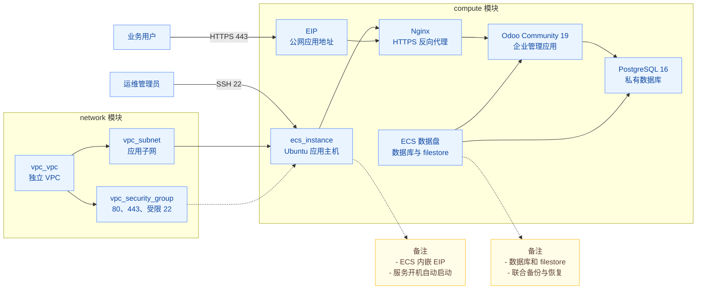

# 快速部署 Odoo 社区版企业管理套件

Odoo 社区版是一款开源、模块化的企业管理套件，帮助企业管理客户与商机、销售订单、采购、库存、生产和项目。各模块共享业务数据，企业可按需启用，串联从客户跟进到订单交付的业务流程，减少重复录入和跨部门协作成本。本方案通过 Terraform 自动创建火山引擎网络、云主机和存储，并由启动脚本完成 Odoo 及其依赖的安装配置。部署过程可审查、可复用，执行前可预览资源变更，减少手工操作与环境差异，便于快速搭建演示、验证和小规模非关键业务环境。

## 1. 业务背景

手工部署 Odoo 常见以下问题：

- **环境不一致**：操作系统、应用构建版本和依赖安装步骤不同，难以复现相同环境。
- **访问边界不清**：公网入口、应用端口和数据库连接缺少明确的访问控制。
- **备份不完整**：数据库记录和附件分开保存，只备份其中一部分无法完整恢复业务。
- **初始化步骤分散**：云主机创建完成后，仍需分别安装软件、创建数据库和配置服务。

本方案将网络、主机和存储定义为可审查的 Terraform 工程，并通过首次启动脚本安装、配置 Odoo、PostgreSQL 和 Nginx。方案采用单台 ECS，适用于演示、功能验证和小规模非关键业务，不提供生产高可用能力。

## 2. 方案概述

- **部署架构**：在私有网络（VPC）内创建一台 Ubuntu 云服务器（ECS），同机运行 Odoo Community 19、PostgreSQL 和 Nginx，通过弹性公网 IP（EIP）提供访问入口。
- **访问方式**：业务用户通过 Nginx 的 HTTPS 入口访问 Odoo，应用和数据库端口不对公网开放；SSH 访问范围由 `admin_cidr` 控制。
- **数据存储**：数据库、附件和自定义模块保存在独立数据盘。备份工具将数据库与文件保存为同一套备份，恢复时配套使用；备份需另行复制到实例外。
- **自动初始化**：首次启动时下载指定构建版本的 Odoo，校验安装包后完成安装，并配置数据库、反向代理和初始管理员凭据。初始 HTTPS 证书为自签名证书，正式接入前需替换为可信证书。



首次启动时会生成自签名 HTTPS 证书。正式接入用户前，必须替换为业务域名的可信证书。启动脚本只初始化 Odoo 基础模块，CRM、销售等社区模块由使用者按需启用。

## 3. IaC 设计

本工程采用基础设施即代码（IaC），使用 Terraform 定义云资源，并通过 VolcengineCC Provider 调用火山引擎资源编排接口。

### 3.1 资源清单

本方案创建 4 个火山引擎资源对象，以及 1 个用于销毁等待的 Terraform 辅助对象。

| Terraform 资源 | 数量 | 用途 |
| --- | --- | --- |
| `volcenginecc_vpc_vpc` | 1 | Odoo 独立网络边界 |
| `volcenginecc_vpc_subnet` | 1 | 指定可用区的应用子网 |
| `volcenginecc_vpc_security_group` | 1 | 公网 80/443 和管理网段 SSH 入站控制 |
| `volcenginecc_ecs_instance` | 1 | Ubuntu 主机及其内嵌网络、存储和启动配置 |
| `time_sleep` | 1 | ECS 删除后、网络删除前的 60 秒等待，不创建云资产 |

EIP、系统盘、数据盘和主网卡随 ECS 一并创建，由 ECS 资源属性统一管理，没有独立的 Terraform 资源地址。应用与数据库安装在 ECS 内，不额外创建托管数据库、负载均衡或对象存储服务。

默认配置下，删除或替换 ECS 会同时删除数据盘。将 `data_volume_delete_with_instance` 设为 `false` 可保留数据盘，但原 ECS 删除后，保留的数据盘不再由该 Terraform 资源地址管理，需单独登记并重新挂载或删除。删除或替换实例前，应将业务备份复制到实例外，操作步骤见第 4.2.4、4.2.5 节。

### 3.2 工程结构

```text
terraform-volcenginecc-enterprise-management-suite/
├── modules/
│   ├── network/
│   │   ├── main.tf
│   │   ├── variables.tf
│   │   ├── outputs.tf
│   │   └── versions.tf
│   └── compute/
│       ├── main.tf
│       ├── variables.tf
│       ├── outputs.tf
│       ├── versions.tf
│       └── templates/
│           └── odoo-bootstrap-native.sh.tftpl
├── main.tf
├── variables.tf
├── outputs.tf
├── providers.tf
├── versions.tf
├── locals.tf
├── terraform.tfvars
├── README.md
└── README.zh-CN.md
```

工程按网络和计算拆分模块：

- **根模块**：配置 Provider、汇总部署参数，组织子模块依赖并设置销毁等待。
- **`network` 模块**：创建 VPC、子网和安全组，将资源 ID 传给计算模块。
- **`compute` 模块**：创建 ECS 及其 EIP、云盘和主网卡，通过 `user_data` 下发应用初始化脚本。

子模块只声明 Provider 版本约束，统一使用根模块的 Provider 配置。

### 3.3 核心代码示例

**资源依赖与销毁顺序**：根模块先创建网络，再创建 ECS；销毁时按 `ECS → 等待 60 秒 → 安全组 → 子网 → VPC` 执行。等待仅作用于销毁阶段，为网卡和安全组关联的释放留出时间，不会自动解除其他资源的占用。以下片段省略了计算模块的其他输入：

```hcl
resource "time_sleep" "before_security_group_destroy" {
  destroy_duration = "60s"
  depends_on       = [module.network]
}

module "compute" {
  source = "./modules/compute"
  # ...
  depends_on = [time_sleep.before_security_group_destroy]
}
```

**应用初始化**：`compute` 模块将 Odoo 版本、安装包 URL、SHA256 和时区填入脚本模板，经 Gzip 压缩和 Base64 编码后，通过 `user_data` 传给 ECS。实例内的 cloud-init 在首次启动时执行脚本，完成应用安装和配置。以下片段省略了其他实例参数：

```hcl
locals {
  bootstrap_script = templatefile("${path.module}/templates/odoo-bootstrap-native.sh.tftpl", {
    odoo_version        = var.odoo_version
    odoo_package_url    = var.odoo_package_url
    odoo_package_sha256 = var.odoo_package_sha256
    timezone            = var.timezone
  })
}

resource "volcenginecc_ecs_instance" "odoo" {
  # 其他 ECS 参数省略。
  user_data = base64gzip(replace(local.bootstrap_script, "\r\n", "\n"))
}
```

### 3.4 软件版本与持久化

| 组件 | 安装来源 |
| --- | --- |
| Odoo Community | aria2 从 Odoo 官方 CDN 下载固定版本 DEB |
| PostgreSQL | Ubuntu 24.04 软件源（主版本 16） |
| 主机系统 | `image_id` 指定的 Ubuntu 24.04 公共镜像 |
| 反向代理 | Ubuntu 24.04 Nginx 软件包 |

`odoo_package_url` 和 `odoo_package_sha256` 用于固定 Odoo 的精确构建版本。默认安装包为 `odoo_19.0.20261018_all.deb`，SHA256 为 `2966e651382c7c7796b7080f35f5907eea2ee50767cbaae9c1ba0909981fdda1`

可按需升级，升级时必须同时更新安装包 URL、SHA256 和 `odoo_version`，并在新环境完成回归测试，不要直接更新现有业务主机。

启动脚本将数据盘挂载到 `/srv/odoo`：

| 路径 | 数据 |
| --- | --- |
| `/srv/odoo/postgresql` | PostgreSQL 数据文件 |
| `/srv/odoo/filestore` | Odoo 附件和 filestore |
| `/srv/odoo/addons` | 自定义 Addons 目录，默认不附带模块 |
| `/srv/odoo/secrets` | 运行时凭据，权限为 `0600` |
| `/srv/odoo/backups` | 本地联合备份集 |

filestore 是 Odoo 在文件系统中保存附件的目录；Addons 指扩展模块。数据库和 filestore 共同组成业务数据，备份与恢复时需配套处理。

模板不附带第三方 Addons。使用前应审查来源和许可证，固定版本，并将代码放入 `/srv/odoo/addons` 后再启用。

脚本预先创建数据库 `odoo`，应用配置固定使用该数据库。同名数据库用户没有超级用户和创建角色权限，但保留 `CREATEDB` 建库权限。若按固定单库的最小权限策略部署，应评估是否需要该权限；收紧权限后，重新验证初始化、模块使用和恢复流程。

Odoo 数据库管理主密码与初始网页登录密码在实例内随机生成，凭据文件正常运行时的权限为 `0600`。主密码还会以明文写入 `/etc/odoo/odoo.conf`；该文件的属主为 root、属组为 odoo，权限为 `0640`，因此 root 和 odoo 组可读取。

上述权限限制了凭据的读取范围，但未加密凭据内容。若使用规范禁止明文存储，需另行调整存储方案。

### 3.5 输入变量

下表列出根模块全部输入。标记为“必填”的变量没有默认值，必须通过 `terraform.tfvars`、InfraManager 参数或命令行提供。

| 变量 | 默认值 | 说明 |
| --- | --- | --- |
| `region` | `cn-beijing` | 部署地域 |
| `zone_id` | 必填 | 子网和 ECS 所在可用区 |
| `project_name` | `odoo` | 资源名称和标签使用的项目标识 |
| `environment` | `demo` | 环境标识 |
| `owner` | 必填 | 资源 Owner 标签 |
| `cost_center` | `shared` | 成本中心标签 |
| `cloud_project_name` | `default` | 火山引擎项目名称 |
| `vpc_cidr` | `10.30.0.0/16` | VPC IPv4 网段 |
| `subnet_cidr` | `10.30.1.0/24` | 应用子网 IPv4 网段 |
| `admin_cidr` | 必填 | 允许 SSH 登录的管理网段 |
| `image_id` | 必填 | 目标地域可用的 Ubuntu 24.04 镜像 ID |
| `ecs_instance_type` | `ecs.g4i.xlarge` | ECS 实例规格 |
| `ecs_login_mode` | `key_pair` | `key_pair` 或 `password` |
| `key_pair_name` | `null` | 密钥对模式使用的已有密钥对名称 |
| `ecs_password` | 演示值，敏感 | 密码模式使用的 ECS 初始密码 |
| `ecs_system_volume_type` | `ESSD_FlexPL` | 系统盘类型 |
| `ecs_system_volume_size_gb` | `40` | 系统盘容量（GiB） |
| `ecs_data_volume_type` | `ESSD_FlexPL` | Odoo 数据盘类型 |
| `ecs_data_volume_size_gb` | `100` | Odoo 数据盘容量（GiB） |
| `data_volume_delete_with_instance` | `true` | ECS 删除时是否同时删除数据盘 |
| `eip_bandwidth_mbps` | `10` | ECS 公网 IP 带宽（Mbps） |
| `odoo_version` | `19.0` | Odoo Community 主版本 |
| `odoo_package_url` | 固定 Odoo 19 DEB URL | Odoo 安装包下载地址 |
| `odoo_package_sha256` | 固定 SHA256 | Odoo 安装包校验摘要 |
| `timezone` | `Asia/Shanghai` | ECS 时区 |
| `additional_tags` | `{}` | 合并到标准标签的附加标签 |

部署前注意变量默认值与示例值的区别：

- `ecs_login_mode` 默认是 `key_pair`，示例 `terraform.tfvars` 使用 `password`。
- `zone_id`、`owner`、`admin_cidr`、`image_id` 没有默认值，示例提供北京地域配置；换地域时需重新核对镜像、可用区及规格。
- 示例 `admin_cidr = "0.0.0.0/0"` 会向全网开放 SSH，应改为实际管理网段。
- 密码模式下，ECS 登录密码会写入 Terraform 状态文件（State）；`sensitive` 只隐藏常规输出中的值，不会加密 State。

### 3.6 输出

| 输出 | 说明 |
| --- | --- |
| `vpc_id` | Odoo VPC ID |
| `subnet_id` | 应用子网 ID |
| `security_group_id` | ECS 安全组 ID |
| `odoo_url` | Odoo 公网 HTTPS 地址 |
| `health_check_url` | Nginx 公网健康检查地址 |
| `ecs_instance_id` | Odoo ECS 实例 ID |
| `ecs_private_ip` | ECS 私网地址 |
| `ecs_public_ip` | ECS 公网地址 |
| `data_volume_id` | PostgreSQL 和 filestore 数据盘 ID |
| `initialization_status_command` | ECS 内初始化和应用状态检查命令 |
| `initial_admin_credentials_command` | ECS 内查看初始 Odoo 管理员凭据的命令 |

Terraform 输出不包含实际 Odoo 密码。`initial_admin_credentials_command` 仅返回查看凭据的命令，需在 ECS 内执行；执行结果包含敏感信息。

## 4. 使用说明

可通过 InfraManager 在云上部署，也可下载工程在本地运行 Terraform。云上部署无需准备本地 Terraform 环境。两种方式都需在资源创建后检查 ECS 内的应用初始化状态。

### 4.1 云上部署

InfraManager 是火山引擎提供的 Terraform 托管工作台，更多产品介绍参见 [InfraManager 产品介绍](https://docs.volcengine.com/docs/infrastructure-management/product-introduction?lang=zh)。

#### 4.1.1 准备权限

为执行资源栈的 IAM 身份或角色授予以下权限：

- CloudControl 资源编排权限。
- VPC、子网、安全组及其规则的创建、查询、更新、删除、关联和标签管理权限。
- ECS、主网卡、系统盘、数据盘和公网 EIP 的创建、查询、更新、删除、关联和标签管理权限。
- 读取目标地域公共镜像、可用区、实例规格和配额所需的权限。

使用具备上述权限的 IAM 身份或资源栈执行角色，不要直接使用主账号，也不要将访问密钥（AK/SK）写入模板参数。在控制台确认 ECS、VPC、EIP 和云盘服务可用、账户余额充足，目标地域的 EIP 配额及所选可用区的实例规格和云盘配额满足要求。

密钥对登录需提前在目标地域创建密钥对，并保管私钥；密码登录需准备符合 `ecs_password` 校验规则的密码。

#### 4.1.2 选择模板

打开 [InfraManager 控制台](https://console.volcengine.com/iac)，进入 **模板管理 > 公开模板**，搜索“快速部署 Odoo 社区版企业管理套件”。

#### 4.1.3 创建资源栈

选择模板并点击 **创建资源栈**，根据实际需求填写资源栈信息和模板参数。创建并检查执行计划，确认变更符合预期后，点击 **执行部署**。

重点核对第 3.5 节的地域、可用区、镜像、规格、管理网段、登录方式、数据盘删除策略及公网带宽。登录方式只能选择密钥对或密码中的一种。

EIP 带宽应在首次部署前确定；修改已有实例的带宽配置可能触发实例替换，应先检查执行计划。参数默认值与示例值的区别见第 3.5 节。

#### 4.1.4 部署验证

资源栈状态为“成功”表示云资源已创建，应用可能仍在初始化。查看第 3.6 节的输出，用 `ecs_instance_id` 和 `data_volume_id` 核对资源，用 `ecs_public_ip` 登录主机，用 `odoo_url` 访问应用。

在控制台核对 VPC、子网、安全组、ECS，以及 ECS 关联的 EIP、主网卡和两块云盘。`time_sleep` 是 Terraform 等待对象，不对应云资产。

在源 IP 属于 `admin_cidr` 网段的管理终端上，选择与登录方式匹配的 SSH 命令，或者直接在云服务器控制台远程连接实例。将占位符替换为资源栈输出的公网 IP；密钥对模式使用对应的私钥：

```bash
# 密码模式：
ssh root@"<ecs_public_ip>"

# 密钥对模式：
ssh -i /path/to/private-key root@"<ecs_public_ip>"
```

在 ECS 内执行：

```bash
sudo cloud-init status --wait
sudo /usr/local/sbin/odoo-status
sudo pg_lsclusters
sudo findmnt /srv/odoo
sudo -u odoo psql -d odoo -c 'select current_database(), version();'
sudo /usr/local/sbin/odoo-credentials
```

预期 cloud-init 初始化完成、状态检查通过、实际 PostgreSQL 集群状态为 `online`，`/srv/odoo` 挂载在数据盘上，数据库名为 `odoo`。

在浏览器打开 `odoo_url`，使用最后一条命令显示的 `odoo-admin` 初始凭据登录，并立即修改密码。首次生成的证书为自签名证书，仅在确认访问目标后用于部署验证；正式接入前需配置可信证书。`health_check_url` 应返回 HTTP 200，普通 HTTP 页面请求应跳转到 HTTPS。

随后执行第 4.2.4 节第 2 至 6 项的网络、业务、重启、备份恢复和变更检查。云上部署时，将 `ECS_IP`、`ODOO_URL`、`HEALTH_URL` 设置为资源栈对应输出，无需本地 State。初始化异常时，按该节检查网络、挂载、日志和数据库集群。

### 4.2 本地部署

以下 Terraform 命令均在工程根目录运行。先按第 4.1.1 节准备权限和服务，并保持本模板创建的子网专用于该部署。

#### 4.2.1 环境准备

**基础环境**：

- Terraform `>= 1.5.7`，能够访问 Terraform Registry 和火山引擎 API。
- Provider 版本约束为 `volcengine/volcenginecc ~> 0.0.72` 和 `hashicorp/time ~> 0.9`。当前工程未提交依赖锁文件（`.terraform.lock.hcl`），初始化后需审核实际解析出的版本，并在各部署环境中保持一致。
- 管理终端需准备 SSH、curl 和用于公网端口检查的 `nc`。目标镜像必须为支持 cloud-init 的 Ubuntu 24.04，ECS 需能访问 Ubuntu 软件源和 `nightly.odoocdn.com`。

**服务与配额**：

按第 4.1.1 节在控制台确认权限、服务、余额、镜像、规格与配额。`image_id` 没有默认值，示例文件提供的镜像仅适用于对应地域，换地域时必须重新选择。默认公网带宽为 10 Mbps，会影响下载耗时，应在首次部署时根据需求选择。

**API 访问凭据**：通过环境变量提供 AK/SK，不要写入代码或 `terraform.tfvars`：

```bash
export VOLCENGINE_ACCESS_KEY="your_access_key"
export VOLCENGINE_SECRET_KEY="your_secret_key"
export VOLCENGINE_REGION="cn-beijing"
```

Provider 使用 `region` 变量配置地域，因此 `VOLCENGINE_REGION` 不会覆盖 `terraform.tfvars` 中的 `region`。应确保地域参数、可用区和镜像匹配，并使用对应环境的凭据。

**ECS 登录密码**：`ecs_password` 用于密码模式的 ECS 管理员登录，虽标记为敏感值，仍会进入 Terraform State。建议通过环境变量注入，不要把实际密码写入 `terraform.tfvars`。

当前源码和示例包含演示密码，使用前必须更换。先删除或注释示例文件中的 `ecs_password`，再设置以下环境变量，否则 `terraform.tfvars` 中的值会覆盖环境变量：

```bash
export TF_VAR_ecs_password="<your-strong-password>"
```

密码需满足变量校验规则：长度为 8 至 30 个字符，至少包含大写字母、小写字母、数字和特殊字符中的三类，仅使用 ECS 支持的字符，且不以 `/` 或 `$6$` 开头。密码模式还要求 `key_pair_name = null`；密钥对模式的设置见下一节。

**重点参数**：

完整参数见第 3.5 节。重点检查 `zone_id`、`image_id`、`owner`、`admin_cidr` 和 `ecs_login_mode`，将示例管理网段 `0.0.0.0/0` 改为批准的管理网段。

数据存储和权限说明见第 3.4 节。Odoo 主密码和初始网页登录密码在实例内生成，与 `TF_VAR_ecs_password` 无关；部署前需确认权限受限的运行配置中保存明文主密码符合使用规范。

#### 4.2.2 场景化部署示例

初始化与校验：

```bash
terraform init
terraform fmt -check -recursive
terraform validate
```

**场景一：使用密码登录部署演示环境。** 保留示例中的登录方式，按第 4.2.1 节注入密码并核对其他参数：

```hcl
ecs_login_mode = "password"
key_pair_name  = null
```

生成并保存执行计划，审阅后部署：

```bash
terraform plan -out=odoo.tfplan
terraform show odoo.tfplan
terraform apply odoo.tfplan
```

预期创建第 3.1 节列出的资源，ECS 启动后自动安装软件。执行计划文件和 State 可能包含敏感值，不要公开；Apply 成功后仍需等待实例内的初始化完成。

**场景二：使用已有密钥对部署。** 将 `terraform.tfvars` 中的对应参数改为以下设置，并填写目标地域已有密钥对的名称：

```hcl
ecs_login_mode = "key_pair"
key_pair_name  = "your-existing-key-pair"
ecs_password   = null
```

`ecs_password = null` 用于清空源码中的演示默认值。按场景一的命令生成、审阅并执行计划，部署架构不变，改用私钥登录。已有实例切换登录方式前，必须检查执行计划是否会替换 ECS，并完成联合备份，将备份复制到实例外。

**场景三：只调整业务标签。** 保留已部署环境的 `additional_tags` 中的原有标签，增加所需标签，例如：

```hcl
additional_tags = {
  Purpose    = "OdooCommunityDemo"
  Department = "sales"
}
```

```bash
terraform plan -out=tags.tfplan
terraform show tags.tfplan
terraform apply tags.tfplan
```

预期仅更新标签，不替换 ECS、网络或云盘。如果执行计划包含替换或删除，应先核对实际差异，再决定是否执行。完成后，在控制台检查标签并重新验证业务访问。

修改内嵌 EIP 的 `eip_bandwidth_mbps`、镜像、登录方式或启动脚本可能触发 ECS 替换，不适用本场景的“仅更新标签”预期。默认删除策略下，实例替换会删除旧数据盘。

#### 4.2.3 部署预期结果

资源范围见第 3.1 节。当前示例配置 40 GiB 系统盘和 100 GiB 数据盘，实际容量以部署参数为准。Apply 完成后查看输出：

```bash
terraform output
terraform output -raw ecs_instance_id
terraform output -raw data_volume_id
```

全部输出见第 3.6 节。在管理终端设置以下变量，供后续验证命令使用：

```bash
ECS_IP="$(terraform output -raw ecs_public_ip)"
ODOO_URL="$(terraform output -raw odoo_url)"
HEALTH_URL="$(terraform output -raw health_check_url)"
```

然后从管理网段按第 4.1.4 节的 SSH 命令登录 ECS，执行下一节的应用验证。

#### 4.2.4 部署后验证

以下步骤标明命令是在管理终端还是 ECS 内执行。云上部署时，使用资源栈输出设置地址，不执行第 4.2.3 节的本地 Terraform 命令。仅在已授权的会话中查看凭据和安装日志，分享前先脱敏。

**1. 检查资源和初始化。** 在 ECS、VPC、云盘和 EIP 控制台核对输出对应的资源，确认 ECS 的子网、安全组、主网卡及 EIP 关联正确，数据盘已挂载到该 ECS，容量与参数一致。云盘挂载到实例后，还需检查操作系统中的文件系统挂载。在源 IP 属于 `admin_cidr` 网段的管理终端上，按第 4.1.4 节的方式通过 SSH 登录，再在 ECS 内执行：

```bash
sudo cloud-init status --wait
sudo /usr/local/sbin/odoo-status
sudo pg_lsclusters
sudo findmnt /srv/odoo
sudo -u odoo psql -d odoo -c 'select current_database(), version();'
```

预期初始化完成、服务检查通过、实际 PostgreSQL 集群状态为 `online`，`/srv/odoo` 挂载在数据盘上，数据库名为 `odoo`。不能仅凭 PostgreSQL 汇总服务处于 `active` 状态判断数据库正常。

初始化失败时，在 ECS 内先检查软件源/CDN 连通性、数据盘挂载与日志：

```bash
sudo cloud-init status --long
sudo tail -n 80 /var/log/cloud-init-output.log
sudo journalctl -u odoo.service -u nginx.service --since '-15 min' --no-pager
sudo pg_lsclusters
```

若实际数据库集群未处于 `online` 状态，按列出的版本与集群名检查对应日志和服务；不要为解决连接问题开放数据库公网端口。排除故障原因后按运维流程恢复，避免在业务主机上主动中断初始化、删除数据目录，或以替换实例代替恢复。

**获取 Odoo 网页登录信息。** 默认登录用户名为 **`odoo-admin`**。初始化完成后，通过 SSH 登录 ECS，再执行以下命令获取初始密码：

```bash
sudo /usr/local/sbin/odoo-credentials
```

命令会显示 `Login` 和 `Initial password`。在浏览器打开输出中的 `odoo_url`，使用 `odoo-admin` 和显示的初始密码登录，并立即修改密码。

该命令读取初始凭据文件，修改网页登录密码后不会显示新密码。请勿公开命令输出。

**2. 检查公网入口和内部端口。** 在管理终端执行，`ECS_IP` 等变量取自部署输出：

```bash
curl --fail --show-error --silent --insecure "$HEALTH_URL" >/dev/null
curl --head "http://${ECS_IP}/"
nc -vz -w 3 "$ECS_IP" 8069
nc -vz -w 3 "$ECS_IP" 8072
nc -vz -w 3 "$ECS_IP" 5432
```

健康检查应返回 HTTP 200，普通 HTTP 页面请求应返回 301 并跳转到 HTTPS，后三个端口的连接应失败或超时。`--insecure` 仅用于已确认目标的临时自签名证书验证，配置可信证书后应移除该参数并检查证书链。

浏览器访问 `odoo_url` 应显示登录页面；登录页面可访问不代表数据库端口对公网开放。结果异常时，先检查安全组、Nginx、Odoo 及本机 8069、8072 端口的状态。

**3. 业务流程验证。** 使用初始账号 `odoo-admin` 登录并修改密码。基础安装不会自动启用 CRM、销售等业务模块，需在应用页面启用 CRM 与销售两个社区模块。

创建客户、产品、商机和销售报价单，让商机与报价单关联同一客户，并检查跨模块数据是否一致。上传并下载一个测试附件，确认内容与原文件一致。

分别在未登录和已登录状态下访问 `/web/database/selector`、`/web/database/manager`，确认数据库选择和管理功能不可用，且不展示数据库列表。

执行会产生通知的业务操作，确认页面没有连接丢失提示。如需排查，在浏览器开发者工具的网络面板中检查 `/websocket` 是否返回 101 升级响应，以及后续消息和 Nginx 到本机 8072 端口的转发。仅登录页面可访问不能证明业务流程全部正常。

**4. 服务与主机重启。** 在验证环境先分别重启应用和实际数据库集群：

```bash
sudo pg_lsclusters
sudo systemctl restart odoo.service
sudo pg_ctlcluster 16 main restart
sudo /usr/local/sbin/odoo-status
```

`16 main` 是默认环境中的集群版本和名称；若 `pg_lsclusters` 显示不同值，按实际版本和名称替换。每次重启后重新登录，检查原有客户、单据及附件。之后在 ECS 内执行：

```bash
sudo reboot
```

实例启动后，通过 SSH 重新登录，检查初始化状态、服务状态和数据盘挂载，再读取原有业务记录和附件。预期服务随主机启动，数据库记录、附件和 filestore 文件保持可用；结果异常时，先检查实际 PostgreSQL 集群、数据盘挂载及服务日志。

**5. 数据库与 filestore 联合备份和恢复。** 备份和恢复期间会停止 Odoo，应根据数据量预留维护窗口。在源 ECS 内执行以下命令，备份保存到以时间戳命名的目录，完成后重新启动应用服务：

```bash
BACKUP_DIR="$(sudo /usr/local/sbin/odoo-backup)"
sudo ls -la "$BACKUP_DIR"
sudo sh -c 'cd "$1" && sha256sum --check SHA256SUMS' sh "$BACKUP_DIR"
```

备份目录应包含 `database.dump`、`filestore.tar.gz` 和 `SHA256SUMS`，校验应通过。将完整备份加密并复制到实例外；保存在同一数据盘上的备份无法应对数据盘丢失。

恢复验证须在隔离的测试环境中进行。先准备相同版本的软件及 Addons，再将完整备份目录安全地复制到目标 ECS，确认目录包含上述三个文件。

在目标 ECS 内，将占位符替换为复制后的目录再执行：

```bash
BACKUP_DIR="<copied-backup-directory>"
sudo env CONFIRM_RESTORE=YES /usr/local/sbin/odoo-restore "$BACKUP_DIR"
sudo /usr/local/sbin/odoo-status
```

恢复会重建目标 `odoo` 数据库，并解包 filestore 和 Addons，不要在正在使用的业务库上执行。恢复后，使用备份时有效的网页登录凭据核对客户、单据及附件；目标实例生成的初始密码文件不代表恢复后的账号密码。

脚本不备份凭据目录或 HTTPS 配置。跨主机恢复时，需单独配置目标主机的运行参数、证书和凭据。完成业务记录和附件验证后，再清理不再需要的测试数据。

**6. 检查变更与幂等性。** 在控制台核对第 4.2.2 节的标签变更，重新登录并确认业务正常。在本地工程目录执行：

```bash
terraform plan
```

在未修改参数的情况下，预期执行计划显示无资源变更。云上部署时，在原资源栈中创建执行计划进行检查，无需本地 State。如出现意外的替换、删除或初始化异常，应先核对参数、Provider 版本和目标环境，再决定是否执行。

#### 4.2.5 销毁资源

先完成第 4.2.4 节的联合备份，确认备份已复制到实例外，并通过校验和恢复验证。

检查该 VPC、子网和安全组是否被其他应用或平台服务复用。若存在依赖，先确认资源归属和删除权限，通过对应服务释放关联后，再删除本模板的网络资源；不要直接删除归属不明的服务网卡。

使用创建资源时的工程、Terraform 工作区、参数和 State 执行：

```bash
terraform plan -destroy
terraform destroy
```

注意事项：

- 审核待删除的资源清单。默认数据盘和系统盘随 ECS 删除，EIP 随 ECS 释放。数据盘保留策略应在首次部署前确定；修改已有环境的策略前，也需检查是否会触发实例替换。
- ECS 删除后等待 60 秒，再删除应用安全组、子网及 VPC。等待不能解除其他服务网卡的占用；遇到资源占用时，应检查整个子网或 VPC 的依赖，不要只查原 ECS 主网卡，也不要以反复重试代替定位。
- 已有环境若缺少 `time_sleep.before_security_group_destroy`，先审阅常规执行计划，确认添加等待对象不会替换业务资源，再执行 Apply 写入 State，之后生成销毁计划。
- 销毁后，`terraform state list` 应无资源，输出也应清空。还需在各控制台核对原 ECS、EIP、两块云盘、主网卡、安全组、子网和 VPC 已按删除策略释放。若保留数据盘，单独登记卷 ID 并重新挂载或删除；State 为空不代表保留的数据盘已释放。
- 云上部署使用原资源栈的销毁流程，同样先审阅计划并检查云端残留。不要混用本地与平台 State；未核对账单前，不能判断费用已结清。

## 5. 适用范围

本方案提供 Odoo 社区版的单机部署与基础运维工具，适用于演示、功能验证和小规模非关键业务。持续使用前，应配置可信证书、落实实例外备份，并确认数据库权限与凭据存储符合使用要求；生产高可用需要另行设计。
